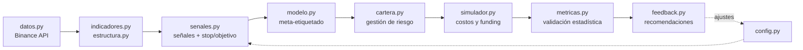

# Rogelio Bot Trading

> Sistema de investigación y trading algorítmico para futuros perpetuos de Binance (USDT-M), construido en Python con validación estadística rigurosa, gestión de riesgo con poder de veto y un bucle de feedback que reentrena su modelo predictivo.


---

## Resumen ejecutivo

**Rogelio** es un agente que analiza 20 criptomonedas en velas de 4 horas, detecta oportunidades a partir de reglas de estructura de mercado, filtra cada señal con un modelo de *machine learning* y decide el tamaño de cada posición según el riesgo de la cuenta. Todo el sistema se evalúa con backtests que simulan comisiones, deslizamiento y funding, y con pruebas estadísticas diseñadas para no engañarse con resultados de suerte.

La versión **2.5** es el candidato para pasar a testnet. Fue elegida después de **68 variantes probadas** y documentadas, incluyendo varias que se descartaron por no tener ventaja fuera de muestra.

### Resultados del backtest (v2.5, 2021–2026)

| Métrica | Valor |
|---|---|
| Rendimiento anual | **23,7%** |
| Caída máxima (drawdown) | **−13,2%** |
| Sharpe | 1,18 |
| Test t mensual | 2,44 |
| Sharpe deflactado (descuenta las 68 pruebas) | 0,83 |
| Años con resultado positivo | **6 de 6** |

| Año | 2021* | 2022 | 2023 | 2024 | 2025 | 2026* |
|---|---|---|---|---|---|---|
| Rendimiento | +10,4% | +23,6% | +21,0% | +32,1% | +12,1% | +34,1% |

\*2021 desde el 9 de marzo y 2026 hasta el 10 de octubre (años incompletos).

### 👉 [Ver la repetición interactiva](https://nico-barrera-01.github.io/rogelio-bot-trading/)

Una página para recorrer el backtest vela por vela, sin instalar nada: cada operación con su entrada, stop, objetivo y resultado, la curva de capital y un simulador de riesgo.

> ⚠️ Son resultados de **simulación histórica**, no de operación real. El rendimiento pasado no garantiza resultados futuros. Ver [Limitaciones](#limitaciones).

---

## Características principales

### 1. Detección de oportunidades
- Tres estrategias independientes basadas en **rupturas de compresión de volatilidad**: el mercado pasa un período "dormido" y luego rompe con volumen y fuerza de tendencia.
- Filtros de contexto con datos de derivados (**funding rate**) y de régimen de mercado (tendencia de BTC).
- Cálculo de estructura sin sesgo de anticipación: swings confirmados, soportes y resistencias con fuerza, perfil de volumen (POC y zona de valor).
- Decisión al cierre de vela y entrada en la apertura de la siguiente, para que el backtest sea ejecutable en la realidad.

### 2. Gestión de riesgo (con poder de veto sobre cualquier señal)
- **Riesgo fijo por operación** expresado en múltiplos R: cada posición se dimensiona para perder un % conocido del capital si toca el stop.
- **Tamaño por Kelly fraccional** (un cuarto de Kelly, con tope), ajustado por la probabilidad que estima el modelo.
- **Límites de cartera:** máximo de posiciones abiertas, máximo por dirección, una posición por moneda y tope de riesgo total abierto.
- **Apalancamiento controlado:** la liquidación siempre queda al menos al doble de distancia que el stop.
- **Cortacircuitos:** pausa diaria tras una pérdida definida y apagado automático si la cuenta cae un % fijo desde su máximo.
- **Calendario de eventos:** no abre posiciones alrededor de eventos macro programados.
- **Escala de riesgo calibrable** (`calibrar.py`) para apuntar a un rendimiento objetivo sin pasar una caída máxima aceptable.

### 3. Stop Loss y Take Profit
- **Stop inicial estructural**, ubicado según el nivel roto y acotado por la volatilidad (ATR).
- **Take profit antes del próximo nivel relevante**, con techo en múltiplos de R, o **sin techo** en la estrategia de tendencia larga.
- **Toma parcial** de la posición en el camino al objetivo.
- **Break-even:** el stop pasa a la entrada cuando la operación avanza lo suficiente a favor.
- **Trailing stop dinámico** basado en ATR para dejar correr las ganadoras.

### 4. Modelo predictivo (meta-etiquetado)
- Enfoque de **meta-labeling** (López de Prado): las reglas proponen operaciones y un modelo de **gradient boosting** estima la probabilidad de que cada una gane, a partir de más de 30 variables de contexto.
- **Validación walk-forward con purga y embargo:** se reentrena cada 6 meses usando solo información que existía en ese momento. Ninguna predicción del backtest "vio el futuro".

### 5. Validación estadística
- Intervalos de confianza de la expectativa, **test t mensual** (corrige la correlación entre operaciones del mismo mes), **Sharpe probabilístico y deflactado**, y simulaciones de **Monte Carlo** sobre la secuencia de operaciones.
- Separación **dentro de muestra (2020–2023) / fuera de muestra (2024–2026)** en todas las optimizaciones.
- Prueba anti-sobreajuste: en datos aleatorios sin ventaja, el sistema debe dar rendimiento cero o negativo.

### 6. Bucle de feedback
Después de cada tanda de operaciones (backtest, testnet o real), `feedback.py` analiza el registro y produce recomendaciones:
- Desglose por estrategia, moneda, régimen de mercado y motivo de salida.
- **MAE/MFE:** cuánto fueron en contra y a favor las operaciones antes de cerrarse (¿el stop está bien ubicado?).
- **Calibración del modelo:** si dice 60% y se gana el 45%, el modelo es optimista.
- **Alarma de deterioro (CUSUM)** para detectar cuando una estrategia deja de funcionar.

---

## Arquitectura



| Módulo | Función |
|---|---|
| `config.py` | Todos los parámetros: universo, perfil de riesgo, costos, reglas y modelo |
| `datos.py` | Descarga incremental de velas cerradas e historial de funding |
| `indicadores.py` | EMA, RSI, ATR, ADX/DMI, MACD, Bollinger, Donchian, OBV, eficiencia de Kaufman, percentiles de volatilidad |
| `estructura.py` | Swings sin mirar el futuro, soportes/resistencias, perfil de volumen |
| `senales.py` | Régimen de mercado y setups de entrada con stop y objetivo |
| `simulador.py` | Simulación vela por vela con comisiones, deslizamiento y funding |
| `modelo.py` | Gradient boosting con validación walk-forward |
| `cartera.py` | Backtest de cartera con todas las reglas de riesgo |
| `metricas.py` | Estadística: IC, test t, Sharpe deflactado, Monte Carlo |
| `eventos.py` + `eventos.csv` | Base de 47 eventos (2020–2026) y estudio de su impacto |
| `feedback.py` | Análisis del registro y recomendaciones |
| `optimizar.py` | Variantes de salida con separación dentro/fuera de muestra |
| `calibrar.py` | Elige la escala de riesgo para el objetivo anual |
| `plan_capital.py` | Proyección de capital con aportes mensuales |
| `graficos.py` | Velas japonesas, curva de capital y distribución de resultados |
| `rogelio.py` | Programa principal que une todo |
| `exportar_web.py` | Convierte los resultados del backtest en los datos de la página de repetición |
| `docs/` | Página de repetición (HTML, CSS y JavaScript, sin dependencias), publicada con GitHub Pages |

---

## Stack tecnológico

| Área | Herramientas |
|---|---|
| Lenguaje | Python 3.10+ |
| Datos y cálculo | pandas, NumPy |
| Machine learning | scikit-learn (gradient boosting) |
| Estadística | SciPy |
| Visualización | Matplotlib; Canvas 2D en JavaScript para la página web |
| Web | HTML, CSS y JavaScript sin frameworks, publicado en GitHub Pages |
| Datos de mercado | API pública de Binance Futures (REST) |
| Entorno de desarrollo | VS Code, entornos virtuales (venv), Git y GitHub |

---

## Instalación y uso

**Requisitos:** Python 3.10 o superior y Git.

```bash
# 1. Clonar el repositorio
git clone https://github.com/nico-barrera-01/rogelio-bot-trading.git
cd rogelio-bot-trading

# 2. Crear y activar un entorno virtual
python -m venv .venv
.venv\Scripts\activate          # Windows
# source .venv/bin/activate     # macOS / Linux

# 3. Instalar dependencias
pip install -r requirements.txt
```

No hace falta ninguna clave de API: el sistema usa solo datos públicos de Binance.

### Flujo de trabajo

| Paso | Comando | Qué hace |
|---|---|---|
| 1 | `python datos.py` | Descarga velas y funding de las 20 monedas (incremental) |
| 2 | `python rogelio.py` | Señales, modelo, backtest, estadística y feedback |
| 3 | `python calibrar.py` | Recomienda la escala de riesgo para el objetivo anual |
| 4 | `python graficos.py BTC 60` | Gráfico de velas con estructura y señales de los últimos 60 días |
| 5 | `python eventos.py BTC` | Estudio del impacto de eventos históricos |
| 6 | `python optimizar.py` | Prueba variantes de salida de cada estrategia |
| 7 | `python feedback.py` | Vuelve a analizar el registro de operaciones |
| 8 | `python plan_capital.py 200` | Proyecta la meta de capital con un aporte mensual de 200 |
| 9 | `python exportar_web.py` | Actualiza los datos de la página de repetición en `docs/replay/` |

Los resultados (informes de texto y gráficos) se guardan en la carpeta `reportes/`. Todos los parámetros se ajustan desde `config.py`.

---

## Desafíos técnicos resueltos

- **Evitar el sesgo de anticipación (*look-ahead bias*).** Los swings, niveles e indicadores se calculan solo con velas cerradas, y el modelo se entrena con operaciones que ya habían terminado, con embargo de 10 días. Es el error más común en backtests de trading y el que más infla los resultados.
- **No confundir suerte con ventaja.** Con 68 variantes probadas sobre los mismos datos, alguna va a "ganar" por azar. Por eso cada versión se evalúa con Sharpe deflactado, test t mensual y validación fuera de muestra, y se lleva la cuenta de las pruebas realizadas.
- **Simulación realista de futuros perpetuos.** El simulador incluye comisiones, deslizamiento y pagos de funding cada 8 horas, además de verificar la distancia a la liquidación según el apalancamiento.
- **Dependencias entre estrategias.** Tres estrategias compiten por los mismos lugares de la cartera. El informe mide cuántas operaciones buenas quedaron afuera por falta de lugar, para decidir presupuestos de riesgo con datos.
- **Robustez del pipeline de datos.** Descarga incremental (solo baja lo nuevo), manejo de monedas sin señales y reintentos ante límites de la API.
- **Una demo que no depende de servidores.** La página de repetición no vuelve a calcular nada: reproduce los resultados exportados del backtest, dibuja las velas y las operaciones en un `canvas` propio y funciona incluso abriendo el archivo sin conexión.
- **Método de investigación disciplinado.** Cuando una versión empeoró por cambiar varias cosas a la vez, se volvió a la base validada y se reintrodujo un cambio por vez, midiendo cada uno por separado.

---

## Proceso de investigación

El proyecto avanzó por versiones, y las que fallaron quedaron documentadas tanto como las que funcionaron:

| Versión | Cambio principal | Resultado |
|---|---|---|
| v1 | Tres setups y un único modelo | Sin ventaja: se reformuló el enfoque |
| v1.1 | Filtro de funding y break-even | Aparece la ventaja |
| v2 | Tres estrategias medidas por separado | Base sólida: 15,9% anual, caída −8,9% |
| v2.1–v2.3 | Velas de 1 hora y cambios simultáneos | Más riesgo o menos rendimiento: descartadas |
| **v2.5** | Base v2 con riesgo calibrado | **23,7% anual, caída −13,2%: candidato a testnet** |

**Lecciones principales:** la ventaja está en temporalidades de 4 horas (en 1 hora se pierde más de la mitad), y las reglas siguieron funcionando sobre 20 monedas que el sistema nunca había visto, la prueba fuera de muestra más exigente que se le hizo.

---

## Limitaciones

- Los resultados son de backtest. El paso siguiente es validar en **testnet** antes de cualquier operación con dinero real.
- El backtest no modela la profundidad del libro de órdenes ni toda la pérdida no realizada dentro de cada operación, así que la caída real puede ser algo mayor.
- Las noticias no se anticipan: el sistema solo evita eventos programados y mide el impacto histórico de los demás.

---

## Mi rol

**Nicolás Barrera** — desarrollador independiente del proyecto, de la idea al sistema funcionando. Lo encaré como un proyecto de investigación: cada decisión tenía que sostenerse con datos.

- **Definí el problema y el perfil de riesgo:** rendimiento buscado, caída máxima tolerable y reglas de corte, antes de escribir una sola estrategia.
- **Dirigí la investigación:** las estrategias se basan en literatura académica y profesional; descarté copiar a los traders de los rankings, cuyos resultados no se sostienen en el tiempo.
- **Diseñé el método de validación:** separación entre datos de diseño y datos nuevos, registro de cada variante probada y una regla fija: una versión solo reemplaza a la anterior si mejora la relación ganancia/riesgo fuera de muestra.
- **Tomé las decisiones de dirección:** reformulé el enfoque cuando la v1 no tuvo ventaja, volví a la base validada cuando cambiar muchas cosas a la vez empeoró los resultados y elegí un riesgo moderado aunque uno más alto mostraba 30% anual.
- **Construí el sistema completo:** datos, indicadores, señales, modelo predictivo, simulador con costos reales, informes estadísticos y la página de repetición, en Python y con desarrollo asistido por IA.

**Próximo paso:** validación en el entorno de prueba de Binance, operando en tiempo real con dinero ficticio.

- LinkedIn: [Nicolás Barrera](https://www.linkedin.com/in/nicolas-barrera-216524241)

### Bibliografía de referencia
López de Prado (*Advances in Financial Machine Learning*), Bailey y López de Prado (2012), Van K. Tharp, Robert Carver (*Systematic Trading*), Perry Kaufman, J. Welles Wilder, Moskowitz, Ooi y Pedersen (2012), Moreira y Muir (2017), Schmeling, Schrimpf y Todorov (BIS, 2023).

---

## Aviso legal

Este proyecto es autónomo y **no es asesoramiento financiero.** El trading de futuros con apalancamiento implica un riesgo alto de pérdida de capital.

## Licencia

Distribuido bajo licencia MIT. Ver `LICENSE`.
